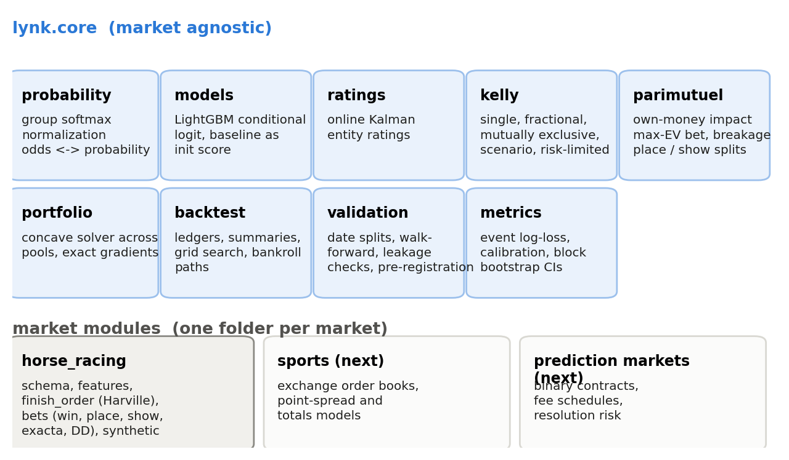

## Problem

The research behind the [fundamental model](../reports/fundamental-model.qmd) and [bet sizing](../reports/bet-sizing.qmd) papers produced more than 80 scripts. They worked, but they were written for one dataset, one machine and one question at a time. Specifically, three things made them hard to reuse:

- **The good ideas were buried in the specific code.** The pari-mutuel solver, the leakage rules and the rating system each lived inside a script that was also tied to one particular data source.
- **The safeguards were habits, not code.** Date splits, lagged features and pre-registered strategy selection were things I remembered to do, which means they were things someone else could forget.
- **Nothing ran without proprietary data.** The racing data behind the research is licensed and cannot be redistributed, so nobody else could run any of it.

**Problem statement:** turn the research into a framework that someone else can install, understand and extend to a new market in an afternoon, with the safeguards built into the functions rather than left to discipline.

## Approach

I designed Lynk around six principles, each one a lesson from the research.

1. **Events come first.** Most wagering markets are groups of mutually exclusive outcomes: horses in a race, teams in a match, candidates in an election. Every probability, metric and sizing function in Lynk works on groups, so probabilities always sum to one inside an event.
2. **Leakage-safe by construction.** Features that use history take a date and only look backwards. Connection records end the day before the event. Ratings used on day D only include results through day D-1. Splits are by date, and there is an assertion that fails loudly when a feature was observed after the decision time.
3. **The market is a baseline, not a feature.** Models accept a baseline log-probability (for example the crowd's odds) as a starting score and learn corrections to it, which is how the strongest models in the research were built [@benter1994].
4. **Prediction, pricing and sizing are separate layers.** A model produces probabilities. A market module turns them into prices (payouts, takeout, own-money impact, breakage). The sizing layer decides stakes. Swapping one layer does not touch the others.
5. **Honest evaluation is a function call.** Results come with day-block bootstrap intervals, returns before and after rebates, drawdown, and a pre-registered selection rule, because those are what keep a backtest from lying.
6. **Every example runs without proprietary data.** A seeded synthetic racing circuit has the same structure and the same traps as real racing, including a crowd that misprices some trainers and smart late money.

The analogy that comes to mind is a full stack application. The core is the backend: it does not care what the market is. Each market module is a frontend that maps its own data and bet types onto that backend. Horse racing is the first frontend, and the next ones should only need a schema, a few features and their own bet types.

{#fig-arch}

### What is in the core

| Module | What it does | Key functions |
|---|---|---|
| `probability` | Group softmax, normalization, odds to probabilities | `group_softmax`, `normalize_within_groups`, `odds_to_probability` |
| `models` | LightGBM conditional logit with an optional market baseline | `fit_group_softmax`, `predict_group_softmax`, `GroupSoftmaxObjective` |
| `ratings` | Online Kalman ratings for any entity in multi-outcome events | `OnlineRatings`, `EntityType` |
| `kelly` | Single, fractional, mutually exclusive, scenario and risk-constrained Kelly | `kelly_fraction`, `kelly_mutually_exclusive`, `kelly_scenarios`, `risk_constrained_kelly` |
| `parimutuel` | Pool payouts with own-money impact, max-EV bet, breakage, dilution, place and show splits | `payout_per_dollar`, `max_ev_bet`, `apply_breakage`, `diluted_actual_payout` |
| `portfolio` | Concave expected-log solver across several pools for one event | `Pool`, `Scenario`, `optimize_portfolio`, `cap_at_max_ev` |
| `backtest` | Ledgers, settlement summaries, grid search, bankroll path simulation | `settle_ledger`, `summarize_ledger`, `grid_search`, `bankroll_paths` |
| `validation` | Date splits, walk-forward windows, leakage assertions, pre-registered selection | `date_split`, `walk_forward_years`, `assert_features_precede`, `select_preregistered` |
| `metrics` | Event log-loss, calibration tables, block bootstrap intervals, drawdown, Sharpe | `group_log_loss`, `calibration_table`, `block_bootstrap`, `ratio_bootstrap` |

: The market-agnostic core. {#tbl-core}

### What is in the horse racing module

| Module | What it does |
|---|---|
| `schema` | The starter-level column contract: keys, pre-race facts, the market snapshot and post-race results |
| `features` | Lagged horse history, trailing-window connection form and field-relative ranks, gaps and z-scores |
| `finish_order` | Discounted Harville pair and triple probabilities, top-k (place and show) probabilities and finish-order scenarios [@harville1973; @lo1995] |
| `bets` | The win strategy (forecast final odds, impact-aware Kelly, 2/3 max-EV cap, diluted settlement) and the multi-pool race solver |
| `synthetic` | A seeded racing circuit: latent ability, trainer and jockey effects, Plackett-Luce results [@plackett1975; @luce1959], a crowd with blind spots and smart late money |

: The horse racing module. {#tbl-hr}

## A walkthrough

The quickstart in `examples/quickstart.py` runs the whole research workflow on a simulated year of racing in about 15 seconds. These are the important steps, in the order the code runs them.

**1. Simulate and validate the data.** The schema check sorts races so every event's rows are contiguous.

```python
from lynk.horse_racing import synthetic, schema
races = schema.validate(synthetic.make_races(n_days=360, races_per_day=10, trainer_mispricing=0.35))
```

**2. Build leakage-safe features.** History is lagged, connection form ends the day before the race and every number gets a field-relative version.

```python
from lynk.horse_racing import features
races = features.add_history_features(races, ['speed_figure', 'finish_pct'])
races = features.add_connection_form(races, 'trainer', window_days=180)
races = features.add_relative_features(races, ['speed_figure_mean3', 'speed_figure_best5'])
```

**3. Rate the connections against past closing prices.** The ratings are updated day by day, and the features for each race only use earlier days.

```python
from lynk.core.ratings import OnlineRatings, EntityType
ratings = OnlineRatings([EntityType('trainer', ['trainer'], prior_variance=0.01),
                         EntityType('jockey', ['jockey'], prior_variance=0.005),
                         EntityType('trainer_track', ['trainer', 'track'], prior_variance=0.003)])
rated = ratings.run(races, 'race_id', 'date', 'won', offset_col='log_closing_p')
```

**4. Split by date, fit a fundamental model and a market model.** The market model starts from the crowd's odds at decision time and learns corrections from the fundamental opinion and the ratings.

```python
from lynk.core import validation
from lynk.core.models import fit_group_softmax, predict_group_softmax
races['split'] = validation.date_split(races.date, valid_start='2023-09-01', test_start='2023-11-01')
market = fit_group_softmax(train[cols], train.won, train.race_id, stop[cols], stop.won, stop.race_id,
                           init_score=train.log_crowd_p.values, init_score_valid=stop.log_crowd_p.values)
```

**5. Bet, choose on validation, score test once.** The strategy prices each horse at the forecast final odds, sizes with the pari-mutuel solver, caps at two thirds of the max-EV bet and settles at the diluted official payoff.

```python
from lynk.core import backtest
from lynk.horse_racing import bets
grid = backtest.grid_search(make_ledger, settings, bankroll=10000.0)
best, active = validation.select_preregistered(grid, metric='log_growth', min_bets=100)
summary = backtest.summarize_ledger(test_ledger)
```

The full run prints:

```{.text}

```

**Reading the output:**

- **The ratings work.** In this simulated world the crowd ignores part of every trainer's skill, and the ratings recover it, improving on the closing prices by 0.013 per race.
- **The market model beats the odds it bets into** (1.8883 versus 1.9201 on the test months), because it combines the crowd with information the crowd ignores.
- **The selection rule picked one setting before the test was scored**, and on test that setting returned +15% on $25,064 of turnover. However, the 95% interval runs from -13% to +45%. Two months and 439 bets are not enough to call it proven, and the framework says so instead of hiding it. When I ran a version of this world with a smaller planted edge, the same rule declared every setting inactive and refused to bet, which is exactly what it should do.

## Testing

The test suite checks the math, not just that the code runs. A few examples:

- **The portfolio gradient matches finite differences** for every stake, so the solver's exact gradients are right.
- **The closed-form max-EV bet matches a brute-force search** over 20,000 stakes.
- **Mutually exclusive Kelly matches a numerical optimizer** on a book with a realistic margin.
- **Ratings recover a planted trainer effect** in simulated races and beat the offset they start from.
- **History features never see today's race,** connection form is zero on the first racing day, and the leakage assertion raises an error when a feature arrives after the decision time.

All 21 tests pass. They run with `pytest` from the repository root.

## Adding a new market

The core never imports a market module, so a new market is a new folder next to `horse_racing`:

1. **Write a schema** that maps the market's data onto events, outcomes, dates and a market snapshot.
2. **Build features** with the same rule: history only looks backwards. The core's `validation.assert_features_precede` can guard the pipeline.
3. **Describe the bet types as pools or fixed-odds bets.** Fixed-odds markets use `kelly_mutually_exclusive` or `kelly_scenarios` directly. Pari-mutuel markets describe each pool with `Pool` and each result with `Scenario`, and the portfolio solver does the rest.
4. **Add a synthetic generator** so examples and tests run without proprietary data.

## Limitations

- **This is version 0.1.** The core is tested, but the horse racing module is a clean re-implementation of research code, not a production betting system.
- **No data connectors.** Racing data is licensed, so the repository ships the schema and a synthetic circuit instead of parsers.
- **The late-money forecast is deliberately simple.** My research stack has a learned late-money simulator that forecasts where each horse's price will close. The framework ships a transparent default and leaves the simulator as the plug-in point it should be.
- **No live execution.** Placing bets, rate limits and track cutoffs for automated bettors are outside the scope of the package.
- **Nothing here is betting advice.** A positive backtest with an interval that includes zero is not proven, and the framework is built to say so.

## What's next

1. The late-money simulator and conditional payout model as first-class plug-ins.
2. Multi-race pools (daily double, Pick 3) in the portfolio solver.
3. A second market module, starting with fixed-odds sports exchanges, to prove the core is truly market-agnostic.
4. API reference pages generated from the docstrings.

Racing taught me most of what is in this package, but very little of it is really about horses. Probabilities that respect the event, prices that respect the pool, stakes that respect the bankroll and tests that respect the calendar apply to any market where people bet against each other. That is what Lynk is for.

## Installation {.unnumbered}

```bash
pip install "lynk[models] @ git+https://github.com/cbhuston/lynk"
```

## References {.unnumbered}

::: {#refs}
:::
