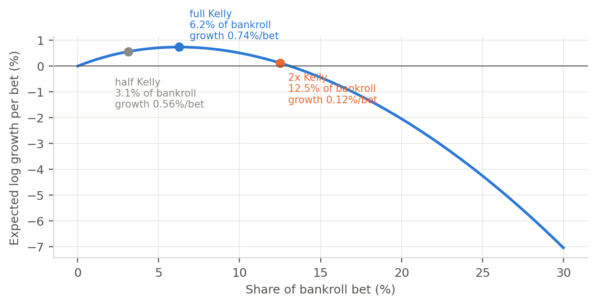
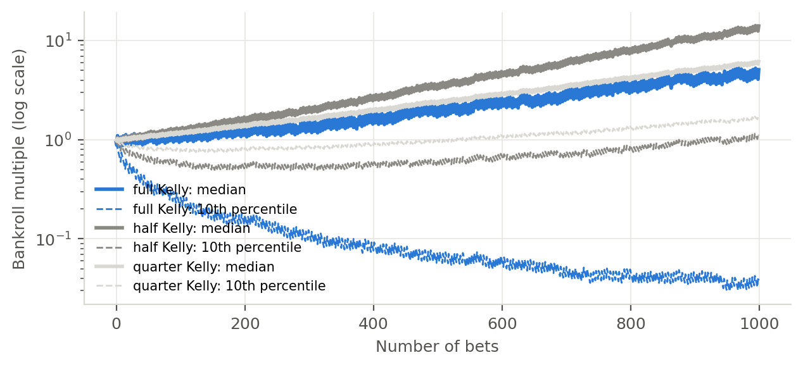
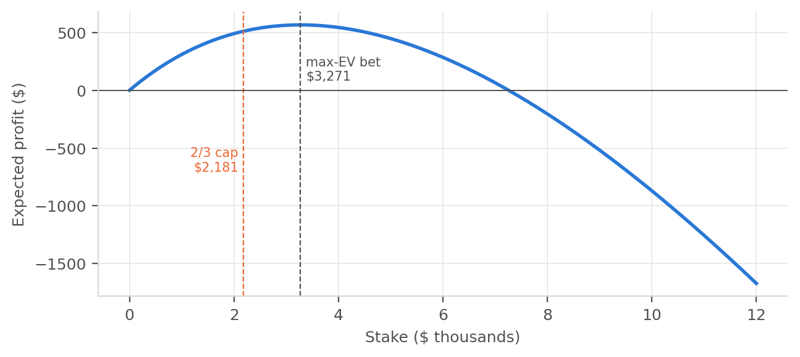
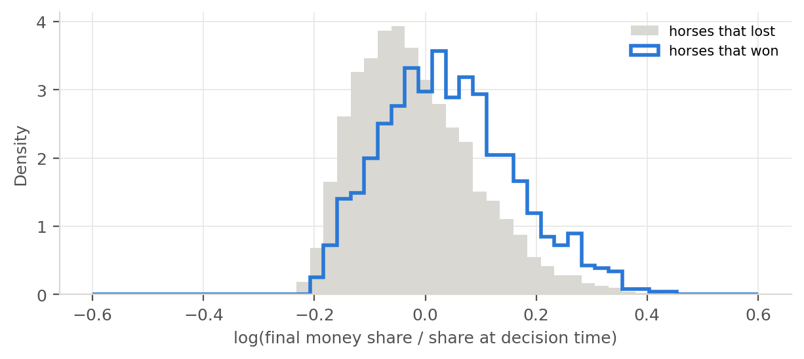
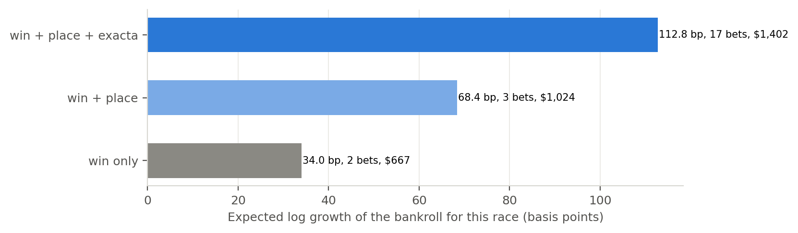

## Problem

Suppose a model says a horse has a 25% chance to win and the tote board shows 4-1, a $5.00 payout per $1. The bet has an edge: $0.25 \times 5 - 1 = +25\%$ per dollar. How much should I bet?

Bet too little and the edge does nothing for the bankroll. Bet too much and a normal losing streak wipes it out, even though every single bet had positive expected value. In a pari-mutuel pool there is a third trap: bet enough and my own money drives the payout down until the edge is gone.

**Problem statement:** turn model probabilities into stakes that grow the bankroll as fast as possible without unacceptable risk, in markets where the price depends on the bet.

The rest of this paper climbs a ladder. Each step fixes one thing the previous step ignored.

| Step | Method | What it adds |
|---|---|---|
| 1 | Kelly criterion | The growth-optimal stake for one bet at fixed odds |
| 2 | Fractional Kelly | Protection against probabilities that are a little wrong |
| 3 | Kelly for mutually exclusive outcomes | Bets in the same race hedge each other |
| 4 | Pari-mutuel impact and the max-EV bet | My own money moves the price |
| 5 | Pricing at the final odds | The odds on the screen are not the odds that pay |
| 6 | The portfolio solver | Win, place, show and exacta sized together |
| 7 | Risk-constrained Kelly | A drawdown limit stated directly |

: The sizing ladder. {#tbl-ladder}

## Step 1: The Kelly criterion

Kelly [-@kelly1956] asked how a gambler with an edge should size bets to make wealth grow as fast as possible over many bets. The answer is to maximize the expected logarithm of wealth, because log wealth adds up across bets while wealth multiplies.

For one bet with win probability $p$ and decimal odds $o$ (net payout $b = o - 1$ per dollar), staking a fraction $f$ of the bankroll gives expected log growth

$$
G(f) = p \log(1 + f b) + (1 - p) \log(1 - f).
$$

Setting $G'(f) = 0$ gives the Kelly fraction

$$
f^* = \frac{p b - (1 - p)}{b}.
$$

**For example,** the 25% horse at 4-1 gives $f^* = (0.25 \times 4 - 0.75) / 4 = 6.25\%$ of the bankroll.

{#fig-growth}

The curve has a shape every bettor should memorize. Half Kelly keeps three quarters of the growth (0.56% versus 0.74% per bet). Twice Kelly keeps almost none (0.12%), and a little past that the growth turns negative: the bankroll shrinks over time even though every bet has a 25% edge. Over-betting is not just riskier, it is slower.

In the Lynk framework this is `lynk.core.kelly.kelly_fraction(p, decimal_odds)`, and `expected_log_growth` draws the curve.

## Step 2: Fractional Kelly

Kelly assumes the probabilities are exactly right. They never are. If the model says 25% but the truth is 23%, the true Kelly stake is 3.75%, and betting 6.25% is already 1.7 times too much.

I simulated 1,000 bets on that horse, 2,000 times, where the model believes 25% and the truth is 23%.

{#fig-paths}

| Sizing | Median bankroll after 1,000 bets | 10th percentile | Chance of falling below half the bankroll at some point |
|---|---|---|---|
| Full Kelly | 5.1x | 0.04x | 79% |
| Half Kelly | **14.1x** | 1.1x | 37% |
| Quarter Kelly | 6.2x | 1.7x | 7% |

: Simulated outcomes with a two-point probability error. {#tbl-paths}

With a small error, half Kelly beats full Kelly on the median outcome too, not just on risk. Full Kelly leaves one path in ten with 4 cents on the dollar. This is why practitioners bet a fraction of Kelly [@maclean2011; @uhrin2021], and why Baker and McHale [-@baker2013] show that shrinking the Kelly stake is the right response to estimation error. Walsh and Joshi [-@walsh2024] make the related point that for betting, a model should be chosen on calibration, not accuracy: Kelly sizes on the probability itself, so a miscalibrated probability is a mis-sized bet.

## Step 3: Mutually exclusive outcomes

In a horse race only one horse can win, so bets on two horses in the same race are not independent. Losing on one horse often means winning on another. Kelly [-@kelly1956] solved this case too, and Smoczynski and Tomkins [-@smoczynski2010] gave an explicit algorithm:

1. Rank horses by expected return $p_i o_i$.
2. Add horses to the betting set $S$ while the next horse's expected return beats the reserve rate
   $R(S) = \dfrac{1 - \sum_{i \in S} p_i}{1 - \sum_{i \in S} 1/o_i}$.
3. Bet $f_i = p_i - R / o_i$ on every horse in $S$ and keep the rest.

Here is a six-horse race with fixed odds:

| Horse | Model probability | Decimal odds | Edge | Separate Kelly | Joint Kelly |
|---|---|---|---|---|---|
| 1 | 32% | 2.6 | -16.8% | 0 | 0 |
| 2 | 24% | 3.6 | -13.6% | 0 | 0 |
| 3 | 16% | 7.0 | +12.0% | 2.00% | **2.17%** |
| 4 | 12% | 7.5 | -10.0% | 0 | 0 |
| 5 | 9% | 12.0 | +8.0% | 0.73% | **0.93%** |
| 6 | 7% | 14.0 | -2.0% | 0 | **0.08%** |

: Joint Kelly bets more on the value horses and even adds a small negative-edge bet as a hedge. {#tbl-mutex}

Two things stand out. The joint solution bets more on horses 3 and 5 than treating them separately, because the two bets cover each other's losses. It also places a small bet on horse 6 even though that bet has a negative edge on its own, because it pays off exactly when the other two lose. In Lynk this is `kelly_mutually_exclusive`, and `kelly_scenarios` solves the general case numerically for any set of outcomes.

## Step 4: My own money moves the price

Everything so far assumed fixed odds. A pari-mutuel pool is different: all the money bet on a race goes into one pot, the track takes its cut (the takeout $t$), and the rest is split among the winning tickets. If the pool total is $T$, the money already on my horse is $m$ and I add a stake $s$, my payout per dollar is

$$
\text{payout}(s) = (1 - t) \, \frac{T + s}{m + s}.
$$

My stake goes into the denominator, so my own bet lowers my own price. Expected profit in dollars is

$$
\text{EV}(s) = p \, s \, \text{payout}(s) - s,
$$

which rises, peaks and then falls. Isaacs [-@isaacs1953] found the peak. Setting $\text{EV}'(s) = 0$ and solving the quadratic gives the maximum expected value bet

$$
s^{*} = -m + \sqrt{\frac{a \, m \, (T - m)}{1 - a}}, \qquad a = p(1 - t).
$$

(Lynk extends it with a rebate $r$ by replacing $1 - a$ with $1 - r - a$.)

{#fig-impact}

**For example,** with $100,000 in the pool and $15,000 on my horse, the edge at a tiny stake is +38%. The best I can do is bet $3,271 for $565 of expected profit, at which point my own money has cut the payout from 5.53 to 4.69. Betting $7,000 earns nothing, and past that every extra dollar loses money. The point is that in a pool, the right question is not only "is this a good bet?" but "how much of this bet can the pool absorb?".

**The 2/3 cap:** I never bet more than two thirds of the max-EV stake, a rule Benter [-@benter1994] described. At two thirds ($2,181) the expected profit is still $510, 90% of the maximum, for one third less money at risk. Lynk implements this as `max_ev_bet` and `cap_at_max_ev`.

## Step 5: Price at the odds that pay, not the odds on the screen

Pari-mutuel odds keep moving until betting closes, and the payout is set by the final pool. A large share of the money arrives in the last minutes, and much of it is well informed [@asch1982]. Recent work on interim odds shows that late odds movement predicts returns even after controlling for the final odds [@hanyu2025]. The practical consequence: **late money tends to pile onto the horses that go on to win,** so a winner's final payout is usually lower than the payout I saw when I bet.

{#fig-late}

In the Lynk synthetic circuit, winners' final money share rose about 4% after the decision time while the average horse's did not move, so a winner paid about 4% less than the screen promised. In real pools I found the same pattern, large enough to turn apparent edges into losses. So the expected value of a win bet has to be priced as

$$
\text{EV} = p \cdot \mathbb{E}[\text{payout} \mid \text{horse wins}] - 1,
$$

using a model of the final pool, conditional on the horse winning, not the current odds. Two lessons from building this:

- **A late-money model is part of the probability model.** Forecasting how much money will arrive on each horse after the bet is a model in its own right, trained on past races where the final odds are known.
- **Price consistently.** If the probability model uses a late-money forecast, the payout must use the same forecast. When I upgraded the late-money model for probabilities but kept the old one for payouts, the strategy got worse at every setting. Making them consistent fixed it.

## Step 6: The portfolio solver

A single race can be bet through several pools at once: win, place (top two), show (top three), exacta (first and second in order) and the first leg of a daily double. Each pool has its own takeout, its own money and its own winners, and my money moves each pool's prices separately. Sizing them one at a time misses the hedges between them and double counts risk.

**Formulation:** list every possible result of the race as a scenario $k$ with probability $\pi_k$. For three places that is every ordered top three, whose probabilities come from the win model through the discounted Harville formula [@harville1973; @lo1995], which corrects plain Harville's tendency to overrate favorites for second and third. (I compared it with the Henery [-@henery1981] and Stern [-@stern1990] models, and a learned second-place model beat all three, so the framework keeps the scenario builder pluggable.) For a pool with $n_k$ winning outcomes in scenario $k$ (one for win and exacta, two for place, three for show), my payout from that pool is

$$
\text{payout}_k(x) = \sum_{w \in \text{winners}} x_w \left(1 + \frac{\Pi_k(x)}{n_k (m_w + x_w)}\right), \qquad
\Pi_k(x) = (1 - t)(T + X) - \sum_{u \in \text{winners}} (m_u + x_u)
$$

where $X$ is my total stake in the pool. Wealth in scenario $k$ is the bankroll, minus all stakes, plus every pool's payout, plus rebates, and the solver maximizes

$$
\max_{x \ge 0} \; \sum_k \pi_k \log \text{wealth}_k(x).
$$

Each payout is a concave function of the stakes, so the whole problem is concave and the solver finds the global optimum. I give it exact gradients and solve with L-BFGS-B.

**One lesson cost me a day:** the first version optimized stakes in dollars. With a $10,000 bankroll, the gradient of log wealth is about one millionth per dollar, and the solver stopped at its starting point, reporting success. Optimizing bankroll fractions instead fixed it. Lynk builds that in.

{#fig-portfolio}

On a six-horse example, win-only betting earns 34 basis points of expected log growth on two bets. Adding the place pool, where my favorite value horse is underbet, doubles that to 68 basis points. Adding the exacta jumps to 113 basis points across 17 bets, and **that is exactly the result not to trust.** In this example the exacta pool was built from a different finishing model than my probabilities, so the solver sees edges that are really a disagreement between two models. A joint optimizer amplifies whichever pool's expected values are most optimistic.

That is what happened in my real research too. Solved jointly across win, place, show and exacta, the optimizer put most of its money into the pools whose predicted edges were least calibrated, and it lost money in validation while the same engine restricted to the win pool made money. **The rule I follow now: a pool only enters the portfolio after its predicted expected values are shown to be calibrated out of sample.** The solver is a powerful tool, and the calibration gate is what keeps it honest.

In Lynk this is `lynk.core.portfolio.optimize_portfolio`, with `Pool` and `Scenario` objects, and `lynk.horse_racing.bets.multi_pool_race_bets` builds the scenarios for a race.

## Step 7: Risk-constrained Kelly

Fractional Kelly controls risk indirectly. Busseti, Ryu and Boyd [-@busseti2016] state the risk limit directly: maximize expected log growth subject to

$$
\sum_k \pi_k \, \text{wealth}_k^{-\lambda} \le 1, \qquad \lambda = \frac{\log \beta}{\log \alpha},
$$

which guarantees that the probability of wealth ever falling to a fraction $\alpha$ of its starting value is at most $\beta$. The problem stays convex.

| Drawdown limit | Stake on the 25% horse at 4-1 |
|---|---|
| Unconstrained Kelly | 6.25% |
| At most 10% chance of ever losing half ($\alpha$ = 0.5, $\beta$ = 0.1) | 2.81% |
| At most 10% chance of ever losing 30% ($\alpha$ = 0.7, $\beta$ = 0.1) | 1.61% |
| At most 5% chance of ever losing 20% ($\alpha$ = 0.8, $\beta$ = 0.05) | 0.83% |

: The same bet under different drawdown budgets. {#tbl-rck}

The appeal is that the risk conversation becomes concrete: "how likely are we to lose 30%?" is a question an investor can answer, while "what fraction of Kelly?" is not. Lynk has it as `risk_constrained_kelly`.

## Evaluating a sizing rule honestly

Sizing rules have settings (an edge cutoff, a Kelly fraction), and choosing them on the same data used to report results is a quiet form of overfitting. Every strategy in my research follows the same protocol:

- **Choose on validation, score test once.** The rule is written down first: among settings with at least 300 bets, pick the highest validation log growth, and only bet if it is positive. Then the test period is scored a single time.
- **Report intervals, not points.** Returns get a 95% interval from resampling whole race days [@kunsch1989].
- **Separate the edge from the rebate.** Rebates (a share of turnover returned by the betting platform) can be most of the margin in pari-mutuel betting [@ziemba2023], so I always report returns before and after rebates.
- **Measure capacity.** Because my money moves the price, profit rises with bet size, peaks and falls. The size where it peaks is part of the strategy, not an afterthought.

## Limitations

- **The solver trusts its scenarios.** If the finish-order probabilities or the pool forecasts are wrong, the solver will confidently size wrong bets. Calibration checks have to come first.
- **One race at a time.** The solver handles all pools in one race, but not correlations across races or across a day's card beyond what fractional Kelly and the drawdown constraint absorb.
- **Late money is forecast, not known.** The final pool is uncertain when the bet is placed. The current framework uses the forecast's mean; carrying its uncertainty into the solver is a natural extension [@metel2017].
- **Execution is outside the math.** Some tracks stop large automated bettors one or two minutes before post, and that changes which snapshot a strategy can use.

## What's next

1. Carry the uncertainty of the late-money forecast into the solver as extra scenarios.
2. Add multi-race pools (daily double, Pick 3) to the portfolio solver with the same calibration gate.
3. Extend the same solver to fixed-odds sports markets, where the impact term disappears but the correlation structure gets richer.

The math in this paper fits on a few pages, and it is all implemented, tested and documented in the [Lynk framework](lynk-framework.qmd). I hope it saves the next person the day I spent watching a solver stop at its starting point.

## Reproducing this paper {.unnumbered}

Every figure and number above is produced by `site/scripts/make_bet_sizing_figures.py` in the [Lynk repository](https://github.com/cbhuston/lynk), using only the `lynk` package and its synthetic racing circuit.

## References {.unnumbered}

::: {#refs}
:::
