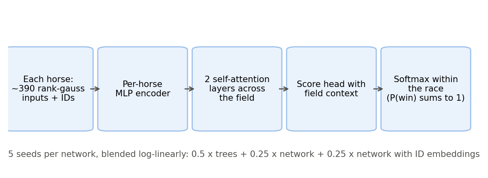
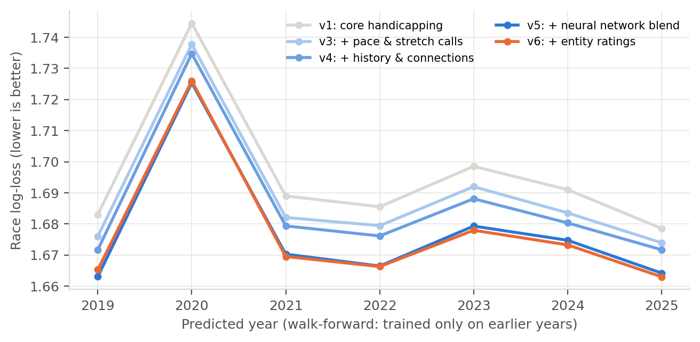
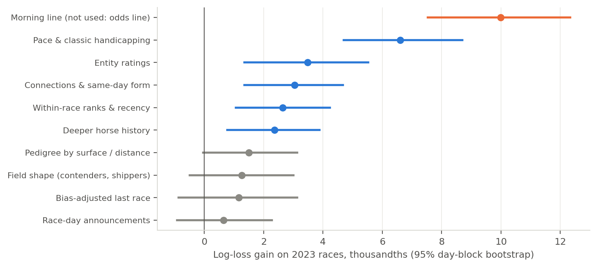
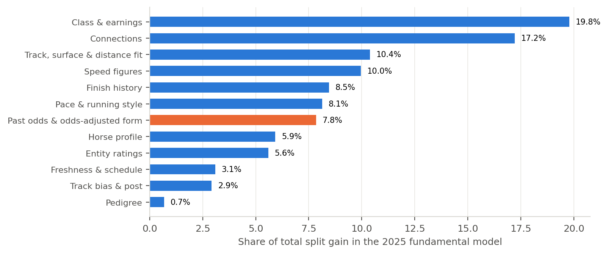
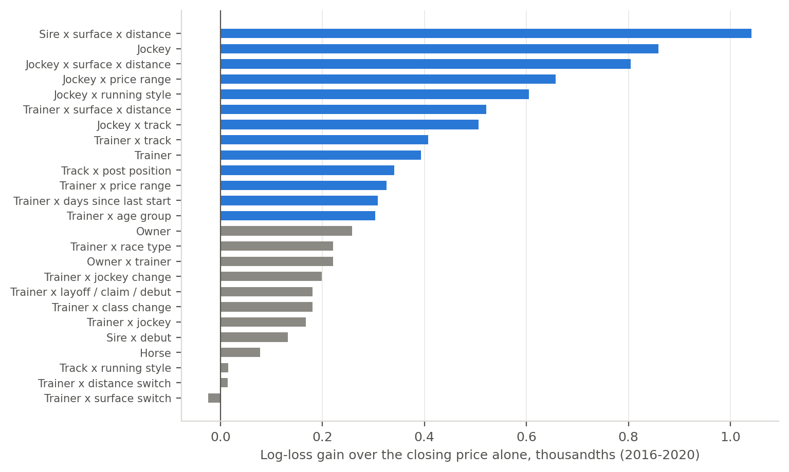

## Problem

Every horse race comes with a crowd. By post time thousands of bettors have put money on each horse, and the tote board turns that money into odds. Those odds are a strong forecast. However, they are also the thing I want to beat, so a model that leans on them only learns to agree with the crowd.

**Problem statement:** build the best possible model of who wins a horse race using only what was knowable before the race from the horses' past performances, and nothing from the betting on the race itself.

There are two practical reasons to want this model on its own:

1. **It is an independent second opinion.** A betting model works by finding where the crowd is wrong. A model that formed its view without the crowd is the cleanest source of disagreement [@benter1994].
2. **Some bets need a probability before any odds exist.** For a daily double or a Pick 3, the later races have no win pool yet when the bet is placed, so the only usable forecast for those legs is a fundamental one.

## Data

**Source:** Daily Racing Form result charts for North American thoroughbred racing from 2012 to 2025: 72,884 chart files covering 648,670 races and 5.58 million starters. For reference, that is about 130 races a day, every day, for fourteen years. If you watched every one back to back at two minutes a race it would take two and a half years without sleeping.

Each chart records the race conditions (track, surface, distance, class, purse), every starter's connections (trainer, jockey, owner, sire, dam), equipment and medication, and the running of the race: the position and lengths behind at each point of call, the final time, the speed figure, the official finish and the payoffs [@drfcharts].

**The leakage rule:** a chart is written after the race, so everything in it is post-race information. I only use chart data in two ways:

- **As history for later races.** A horse's speed figure from its last start is a feature for its next start. Connection records (a trainer's wins) use a trailing window that ends the day before the race.
- **As the label.** Who won today is the target, never an input.

Same-day features (for example, how a jockey has done in earlier races on today's card) only use races that were already official before the race being predicted.

**What is not in the data:** workouts, veterinary records, trip notes in structured form, and anything from the betting on the race being predicted. The morning line (the track handicapper's odds line) is available, and I tested it separately, but it is an odds line, so I keep it out of the fundamental model on purpose.

**The splits:** I use a walk-forward design. To predict year Y, the model trains on races from 2016 up to the middle of year Y-1, uses the last six months of Y-1 to decide when to stop training, and then predicts all of year Y. It never sees year Y before it predicts it. Random train/test splits are the most common mistake in sports modeling: they let horses from the same race and the same day sit on both sides of the split, which leaks the answer and makes the model look much better than it is [@kaufman2012; @roberts2017].

## Approach

### The model thinks in races, not horses

A horse race has exactly one winner, so the model should produce probabilities that add up to one within each race. I use the conditional logit, the same structure Bolton and Chapman [-@bolton1986] and Benter [-@benter1994] used for handicapping, which goes back to McFadden's choice models [-@mcfadden1974]:

$$
P(\text{horse } i \text{ wins}) = \frac{e^{s_i}}{\sum_{j \in \text{race}} e^{s_j}}
$$

Each horse gets a strength score $s_i$, and the probabilities come from comparing those scores within the race. Adding a strong rival automatically lowers everyone else's chance. The scores come from gradient boosted trees [@friedman2001; @ke2017] trained with a custom objective that minimizes this within-race log-loss directly.

**How I score models:** race log-loss, the average of $-\log p$ for the probability the model gave the actual winner. Lower is better. A model that gives the winner 25% scores 1.39 on that race, 40% scores 0.92. Differences of 0.002 to 0.02 sound tiny, but a gain of 0.02 means the model puts about 2% more probability on the eventual winner on average, across every race it ever predicts. Every gain below is measured with a 95% confidence interval from a bootstrap that resamples whole race days, since races on the same day share tracks, weather and surface conditions [@efron1993; @kunsch1989].

### Feature families

I built about 250 features, grouped into families. Every one is built from earlier races only.

| Family | What it captures | Examples |
|---|---|---|
| Speed figures | How fast the horse has run, adjusted for track and distance | last figure, best of last 3, average of last 5, figure trend, best at today's distance |
| Pace and running style | Where the horse is early and how it finishes, rebuilt from points of call | early and mid-race pace figures, stretch gains, lone speed, pace scenario of today's field |
| Finish history | Results, not just times | finish position, lengths beaten, win and in-the-money rates, troubled trips |
| Class and earnings | The level the horse competes at | earnings per start, purse and claiming price versus recent races, class drop or rise |
| Track, surface and distance fit | Whether today suits the horse | record on this surface, at this track, at this distance, first time on turf, first route |
| Connections | The people around the horse | trainer and jockey win rates, trainer-jockey combination, trainer at this track, claim and layoff patterns, same-day form |
| Pedigree | What the bloodline does in these conditions | sire record by surface and distance, sire with first-time starters, dam's other runners |
| Freshness and schedule | Readiness | days since last race, second start off a layoff, starts in the last year |
| Track bias and post | Today's surface and the gate | same-day bias from earlier races on the card, post position record |
| Past odds and odds-adjusted form | How the horse has run relative to its past closing prices | average past closing probability, wins versus what its past prices expected |
| Horse profile | The animal | age, sex, gelding status, weight carried |
| Entity ratings | Long-run tendencies of trainers, jockeys, sires and owners (see below) | trainer at this track, jockey by surface and distance, sire by surface and distance |

: The fundamental feature families. Past-race closing prices come from the official charts and are only ever used as history. {#tbl-families}

**Field context:** every key number also appears in a relative form: its rank in today's field, its gap to the best horse in the race and its standardized value within the race. A 90 speed figure means little until you know whether the next best horse ran 70 or 95. These relative versions turned out to carry 43% of the model's total importance, which is the clearest sign that horse racing is a contest against today's field, not against a stopwatch.

**Classic handicapping, rebuilt:** speed figure handicapping [@beyer1975] and pace handicapping [@quirin1979] are decades old, but the charts only expose them indirectly. I rebuilt early, middle and late pace figures from the position and lengths behind at each point of call, measured against prior-year pars for the same track and distance. I also re-read the stretch call from the raw chart files, because the standard parse dropped it.

### A neural network that reads the whole field

Trees score each horse mostly on its own row. A race is a set of horses that interact: two speed horses will burn each other out, and a single closer benefits. To capture that I built a neural network with self-attention layers [@vaswani2017], the same mechanism language models use to relate words in a sentence, applied to the horses in a race.

{#fig-nn}

The network alone was about as good as the trees. However, the two make different mistakes, so a fixed blend (half trees, a quarter each of two five-seed network ensembles) beat the trees by 0.006 to 0.010 in every single year from 2019 to 2025, with every confidence interval clear of zero. That consistency is the result I trust most in this whole project: a gain that shows up in seven separate years is not luck.

### Entity ratings: separating the trainer from the jockey from the horse

The classic way to measure a trainer is a win-rate window: wins over the last 365 days, maybe compared with how often the trainer's horses were expected to win. Win-rate windows have three problems:

- **Confounding.** Top trainers use top jockeys on good horses, so a window credits all three with the same wins.
- **Small samples.** A trainer with six starts off a layoff and two wins looks like a genius.
- **Wrong yardstick.** Raw win rate says who is good. What I want to know is who is better than their horses' prices suggest.

The ratings fix all three. Every past race is modeled as a conditional logit whose baseline is the race's closing probabilities from the chart, plus an effect for each trainer, jockey, horse, owner and combinations such as trainer at a track, trainer off a layoff or after a claim, jockey by surface and distance, and sire by surface and distance (18 types in all). After each racing day, every effect is updated with that day's results, and all of them are estimated together, so a trainer only gets credit for what the jockey and the horse do not explain.

Each rating carries its own uncertainty, like a Kalman filter [@kalman1960] or a Glicko chess rating [@glickman1999]. The analogy that comes to mind is Elo for chess [@elo1978], except every player also has an error bar: a surprising win moves a new trainer's rating a lot and a veteran's rating a little. Ratings used to predict a race on day D only include results through day D-1.

## Results

### Year by year

{#fig-walkforward}

| Version | What was added | 2019 | 2021 | 2023 | 2025 |
|---|---|---|---|---|---|
| v1 | Core handicapping | 1.6830 | 1.6890 | 1.6985 | 1.6785 |
| v3 | Pace and stretch calls | 1.6760 | 1.6821 | 1.6920 | 1.6739 |
| v4 | Deeper history, connections, ranks | 1.6717 | 1.6794 | 1.6881 | 1.6717 |
| v5 | Neural network blend | **1.6630** | 1.6703 | 1.6793 | 1.6642 |
| v6 | Entity ratings | 1.6653 | **1.6695** | **1.6780** | **1.6630** |

: Race log-loss by year (lower is better). A random pick scores about 1.97. {#tbl-years}

Each version improved on the last in every year, with one exception I explain below: v6 is slightly worse than v5 in 2019 and 2020. From v1 to v6 the model gained 0.016 to 0.021 per year. On the most recent unseen period (July 2024 to January 2025) the fundamental model's top pick won 35.1% of races, against about 13% for a random horse in the average 7.5-horse field, with an AUC of 0.76.

### Which families matter

I measure each family the same way: add it to the model, train on 2019 to mid-2022, stop on late 2022, and score every race in 2023, a year the model has never seen.

{#fig-gains}

The verdicts:

- **Pace and classic handicapping is by far the biggest fundamental gain** (+0.0066, interval +0.0047 to +0.0087). Rebuilding pace figures from the points of call was worth more than any other single idea.
- **Entity ratings (+0.0035), connections and same-day form (+0.0030), within-race ranks (+0.0026) and deeper horse history (+0.0024) are all real**, with intervals clear of zero.
- **Pedigree, field shape, bias-adjusted last race and race-day announcements are not significant** on top of everything else. They are not useless on their own, but the other families already carry their information.
- **The morning line would add +0.010**, more than any fundamental family. That says a good human handicapper's line still knows things the charts do not, which is useful to know. I keep it out because the point of this model is to be odds-free.

{#fig-importance}

Inside the model, class and earnings (20%) and connections (17%) carry the most weight, followed by surface and distance fit (10%) and speed figures (10%). Pedigree barely registers. Speed figures matter less than handicapping folklore suggests, because once the model knows the class level a horse competes at and how it finished, the raw time adds less.

### What the ratings found

{#fig-ratings}

Measured alone against the closing price, the most useful ratings were sire by surface and distance, jockey, jockey by surface and distance, jockey by price range and running style, and trainer by surface and distance. The horse's own rating added almost nothing, which makes sense: the market watches horses closely, but it does not keep careful books on how a sire's offspring handle a mile on turf. All 18 types together improved on the closing price by 0.0019 on 2021 to 2022 races that were never used for tuning.

The most interesting finding was about time. I let every rating drift, so a trainer could get hot or cold, and tuning chose almost no drift at all. In other words, the market misprices durable tendencies, not streaks. A trainer who is good with layoff horses stays good with layoff horses, while the hot trainer of the last month is already in the price.

### What did not work

- **Language model trip notes.** I had a local language model tag chart comments (blocked, wide, steadied) into eleven trip categories. A controlled test showed no gain (1.6908 versus 1.6905). The structured chart fields already carry that signal.
- **ECDF transforms**, which turn each figure into a percentile of a historical distribution. No gain over the within-race ranks.
- **Hot and cold streaks** for trainers and jockeys, as described above.
- **Bias-adjusted last race**, which credits horses that ran against a track bias. Small and not significant.
- **Model tuning.** Re-tuning the trees moved log-loss by less than 0.0005. Every real gain came from new information.

::: {.verdict}
**Verdict:** the fundamental model improved by about 0.02 in log-loss across every year from 2019 to 2025, and almost all of that came from three ideas: rebuilt pace figures, field-relative features and the neural network blend. Entity ratings help the most recent years. Consistency across seven separate years is what makes me confident these are real gains and not a lucky test period.
:::

## Limitations

- **The ratings are young in the early years.** The ratings start in 2012, so the 2016 to 2018 training rows see immature ratings. That is why v6 is slightly worse than v5 in 2019 and 2020 and better from 2023 on. Ranking the ratings within each race should fix this, and it is the next experiment.
- **No workouts.** Published workouts are one of the few pre-race facts a human handicapper uses that this model does not have, so I expect them to be the largest remaining gain.
- **One country, one breed.** Everything here is North American thoroughbred racing. Harness racing and international racing have different structures.
- **2020 is an outlier.** The pandemic year had closed tracks and unusual fields, and every version scores worst there. The walk-forward design handles it honestly, but it is a reminder that racing conditions shift.
- **Fundamentals alone do not beat the closing price.** This model is a strong independent opinion, not a betting system. The [bet sizing paper](bet-sizing.qmd) covers how a probability turns into a bet.

## What's next

1. Within-race ranks of the entity ratings, to remove the early-year drift.
2. Workouts and structured trip information as new pre-race inputs.
3. A neural network trained on the ratings directly, instead of blending them in afterwards.
4. Porting the feature pipeline into the open [Lynk framework](lynk-framework.qmd), so anyone can run the same leakage-safe workflow on their own data.

I think the biggest takeaway is how far honest testing gets you. Every gain on this page held up on years the model had never seen, and that is the only kind of gain worth building on.

## References {.unnumbered}

::: {#refs}
:::
