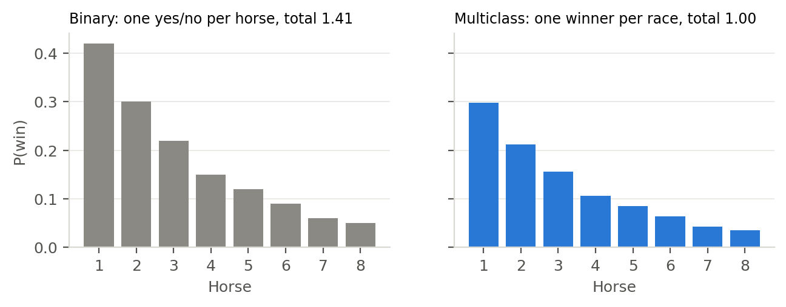
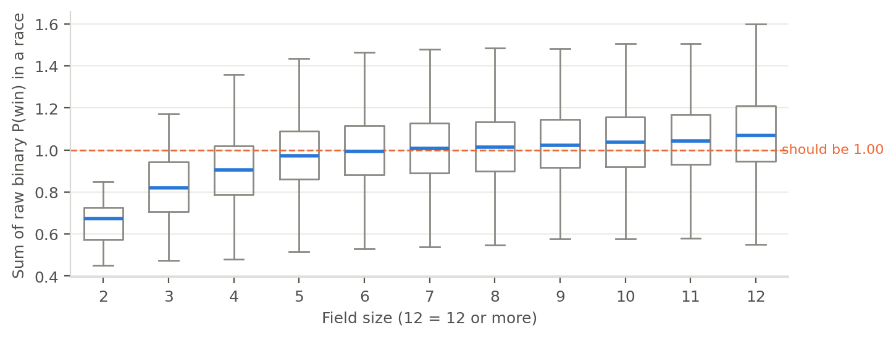
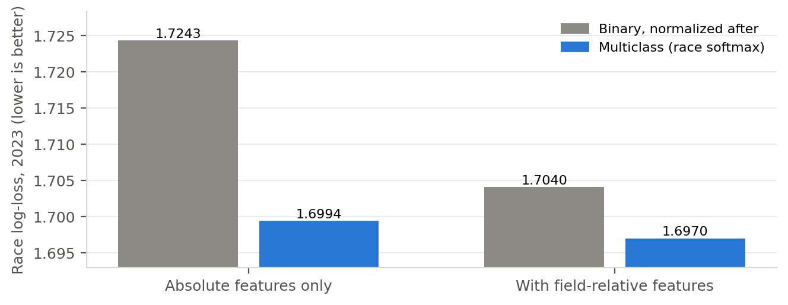
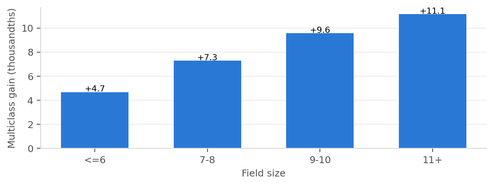
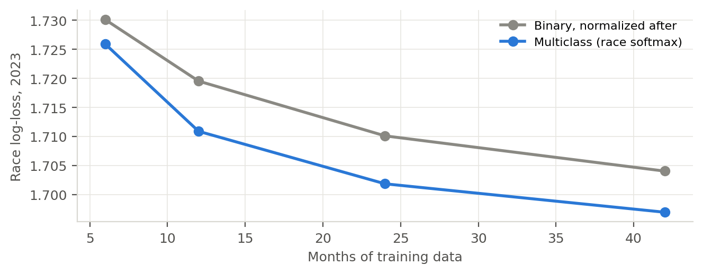

## Problem

Most machine learning tutorials and AutoML tools start from a table where every row is an example and the label is yes or no. A horse race fits into that table easily: one row per horse, label 1 if it won, 0 if it lost. My first generation of models at Lynk were built exactly like that, as per-horse classifiers.

However, a horse race is not a set of independent yes or no questions. Exactly one horse wins, and whether a horse wins depends entirely on who else is in the race. A horse that would be the favorite against a weak field is a longshot against a strong one, without anything about the horse changing.

**Problem statement:** does it matter whether the model is set up as binary classification (does this horse win?) or as multiclass classification over the field (which horse in this race wins?), and if so, how much and why?

## Data

**Source:** the same Daily Racing Form result charts behind the [fundamental model paper](fundamental-model.qmd) [@drfcharts]. The experiment uses 1.32 million starters from 2019 to 2023, which is every North American thoroughbred race over five years.

**Features:** only the fundamental (no odds) features, built strictly from races before each race. I split them into two sets:

- **Absolute (174 features):** speed figures, finishes, class, connections, freshness and fit, without any comparison to today's field.
- **Full (239 features):** the same plus the hand-built field-relative versions, such as a horse's rank in the race and its gap to the best figure in the field.

**Splits:** train on January 2019 to June 2022, stop training on July to December 2022, and score every race in 2023, a year neither model has seen.

## Approach

### Two ways to frame the same race

**Binary classification** scores each horse on its own with the logistic function, $p_i = \sigma(s_i)$, and trains on the binary log-loss

$$
\mathcal{L}_\text{binary} = -\sum_i \big[\, y_i \log p_i + (1 - y_i) \log (1 - p_i) \,\big].
$$

Nothing forces the probabilities in a race to add up to one. A common fix is to divide each race's probabilities by their sum after the model is trained, which I test below as "binary, normalized after".

**Multiclass classification** treats the race as one choice among its starters. Each horse still gets a strength score $s_i$, but the probabilities come from comparing the scores inside the race:

$$
p_i = \frac{e^{s_i}}{\sum_{j \in \text{race}} e^{s_j}}, \qquad
\mathcal{L}_\text{multiclass} = -\sum_{\text{races}} \log p_{\text{winner}}.
$$

This is the conditional logit [@mcfadden1974], the model Bolton and Chapman [-@bolton1986] and Benter [-@benter1994] used for handicapping, and the same idea as listwise learning to rank [@cao2007]. The number of classes changes from race to race (it is the field size), which is why standard multiclass classifiers with a fixed number of classes do not fit and a custom objective is needed.

{#fig-concept}

### Why the objective changes what the model learns

The difference shows up in the gradient, the signal each training example sends back to the trees. For a horse that lost, the binary gradient is just $p_i$: "this horse's own probability was too high". It does not depend on the rivals at all. The multiclass gradient is $p_i - y_i$ where $p_i$ already depends on every rival's score: "this horse's probability was too high relative to this field". Every training race becomes a lesson in comparison.

Think of it like grading on a curve. The binary model grades every horse on an absolute scale, as if it were running against a stopwatch. The multiclass model grades every horse against the other horses in the room, which is how a race is actually decided.

### The experiment

To isolate the effect of the framing, I changed one thing at a time:

- **Model:** LightGBM gradient boosted trees [@ke2017] with identical settings (learning rate 0.05, 63 leaves, at least 300 rows per leaf) and early stopping. The only difference is the objective: binary log-loss or the within-race softmax.
- **Normalization:** the binary model is scored twice, once as is and once with its probabilities rescaled to sum to one in each race.
- **Feature sets:** both objectives are trained on the absolute set and on the full set, so I can see how much of the field comparison each one learns by itself.
- **Training size:** both objectives are also retrained on the last 6, 12, 24 and 42 months before the stopping window.
- **Scoring:** race log-loss, the average of $-\log p$ for the actual winner, with a 95% interval from a bootstrap that resamples whole race days [@efron1993]. Lower is better.

## Results

### Binary probabilities do not form a race

{#fig-sums}

Left alone, the binary model's probabilities for a race summed to anywhere from 0.73 to 1.32 (5th to 95th percentile), and that was the better of the two feature sets. With absolute features only, the range was 0.54 to 1.53. The error is not random: in two-horse races the probabilities summed to 0.67 on average and in fields of twelve or more to 1.07. In other words, the binary model systematically underrates horses in small fields and overrates horses in big fields, because it never learned that the number of rivals matters.

Normalizing after the fact fixes the sums. It also improves the log-loss a lot (from 1.7784 to 1.7243 with absolute features). However, it cannot fix what the model learned during training, which is where the multiclass objective earns its keep.

### The headline

{#fig-headline}

| Features | Binary, normalized after | Multiclass | Multiclass gain | 95% interval |
|---|---|---|---|---|
| Absolute only | 1.7243 | **1.6994** | **+0.0249** | +0.0225 to +0.0276 |
| With field-relative features | 1.7040 | **1.6970** | +0.0071 | +0.0048 to +0.0094 |

: Race log-loss, 2023, same data and trees, objective changed. {#tbl-headline}

With the same raw features, switching the objective gained 0.025. For reference, that means the multiclass model puts about 2.5% more probability on the eventual winner, on average, across all 34,458 races in 2023. That is nearly four times the gain from the best fundamental feature family I built (pace and classic handicapping, +0.0066) and nearly three times the gain from blending in a neural network. A one-line configuration change beat weeks of feature engineering.

### The multiclass model learns the comparison on its own

The most interesting result is how the two framings interact with the field-relative features:

- Adding hand-built field-relative features improved the **binary** model by **0.020**.
- The same features improved the **multiclass** model by only **0.0024**.
- The multiclass model with **absolute features only** (1.6994) beat the binary model **with** all the field-relative features (1.7040) by 0.0046 (interval +0.0021 to +0.0072).

The point is that the comparisons I spent weeks hand-building (rank in the race, gap to the best figure, standardized values within the field) are mostly things the multiclass objective figures out by itself, because every gradient it sees is already a comparison. The binary model needs them spelled out and still falls short.

### Bigger fields, bigger gains

{#fig-field}

The advantage grows with the number of rivals: +0.0047 in fields of six or fewer, +0.0073 in fields of seven or eight, +0.0096 in nine or ten and +0.0111 in fields of eleven or more. That is what the theory predicts. The more horses in a race, the more the outcome depends on the field rather than on the horse alone, and the more a model that only grades on an absolute scale gives up.

### Half the data

{#fig-size}

The multiclass model was better at every training size I tried: 6, 12, 24 and 42 months. Trained on 24 months it scored 1.7019, already better than the binary model trained on all 42 months (1.7040). Every race teaches the multiclass model something about every horse in it, so it extracts more from the same data.

### Where it does not help

Picking the winner barely changes. The top pick won 33.6% of 2023 races with the multiclass model and 32.8% with the binary model on absolute features, and the two were within 0.2 points of each other on the full set (33.3% versus 33.5%, slightly in the binary model's favor). The gain is almost entirely in the quality of the probabilities across the whole field: how much the 15% horse and the 4% horse really deserve.

For a bettor that is the part that matters. A bet is only worth making when the model's probability differs from the price, and the Kelly stake is sized directly from that probability [@kelly1956]. A model that picks the same winners with better probabilities finds better prices and sizes them better, which is why I agree with Walsh and Joshi [-@walsh2024] that betting models should be judged on calibration and log-loss, not accuracy.

::: {.verdict}
**Verdict:** framing the race as one multiclass choice instead of many binary questions was worth +0.025 in log-loss on identical data, more than any feature I ever built. It learns the comparison against the field on its own, helps most in big fields and needs about half the data. It does not pick more winners. It prices them better, and pricing is the whole game.
:::

## Limitations

- **One market, one model family.** This is North American thoroughbred racing with gradient boosted trees. I expect the result to hold for any one-winner event (the neural network in the fundamental paper uses the same within-race softmax), but I have only measured it here.
- **A well-engineered binary model closes most of the gap.** With full field-relative features the difference falls from 0.025 to 0.007. It is still significant and still large in betting terms, but most of what the multiclass objective does can be approximated by enough feature engineering.
- **It needs a custom objective.** Off-the-shelf multiclass classifiers assume a fixed number of classes. The race softmax has to be written as a custom objective, which is one reason so many models default to binary. The [Lynk framework](../code/lynk-framework.qmd) ships one (`GroupSoftmaxObjective` and `fit_group_softmax`).
- **Winners only.** This framing models the winner. Place, show and exotic bets need the full finishing order, which takes Harville-style or staged models on top [@harville1973; @lo1995].

## What's next

1. A listwise objective over the top three finishers (a Plackett-Luce likelihood [@plackett1975]) instead of the winner only, so the model is trained directly for place, show and exacta pricing.
2. The same head-to-head in other one-winner markets: three-way soccer results, golf and futures markets.
3. Combining the race softmax with the market's odds as a starting point, which is how the framework's market models are built.

I think the broader lesson goes beyond racing. Before reaching for a better model or more features, it is worth asking whether the problem is framed the way the world actually works. In a race, one horse wins, and the model should know that.

## Reproducing this {.unnumbered}

The race softmax objective is `lynk.core.models.GroupSoftmaxObjective` in the [Lynk repository](https://github.com/cbhuston/lynk). A minimal version of the comparison on the synthetic racing circuit:

```python
from lynk.core.models import fit_group_softmax, predict_group_softmax
from lynk.core.metrics import group_log_loss

# multiclass: probabilities compete within each race
booster = fit_group_softmax(X_train, won_train, race_id_train, X_stop, won_stop, race_id_stop)
p = predict_group_softmax(booster, X_test, race_id_test)
print(group_log_loss(p, won_test, race_id_test))
```

## References {.unnumbered}

::: {#refs}
:::
